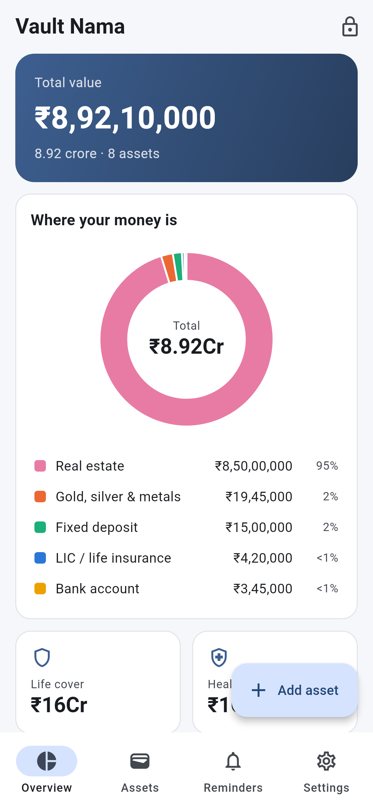
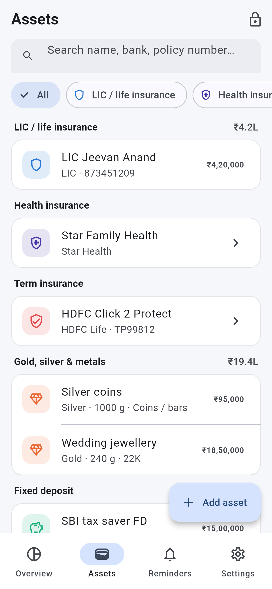
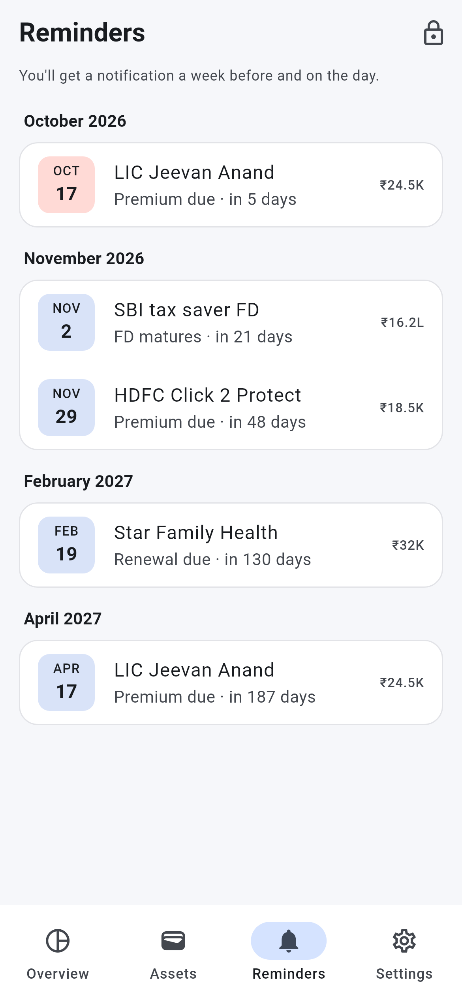

# Vault Nama

An offline-only mobile app for keeping a record of your assets: LIC and other
life policies, health and term insurance, gold and silver, fixed deposits,
bank accounts and real estate.

Nothing leaves the phone. There is no server, account or network access.

## Screens

| Overview | Assets | Reminders |
|---|---|---|
|  |  |  |

Screenshots use sample data and are regenerated with
`flutter test tool/screenshots_test.dart --update-goldens`.

## Security

- Data is stored in a SQLCipher-encrypted SQLite database.
- The database key is random and kept only in the Android Keystore / iOS Keychain.
- The app is locked with a 4–8 digit PIN (stored as a salted PBKDF2 hash), with
  optional fingerprint or Face ID unlock. It locks again whenever it goes to
  the background.
- Android cloud backup and screenshots are disabled.
- Reminders are local notifications scheduled on the phone (a week before and
  on the day, at 9am). Their text is hidden on a locked screen.
- Backups are `.vnbackup` files encrypted with AES-256-GCM, using a key
  derived (PBKDF2-HMAC-SHA256) from a backup password you choose. You save the
  file wherever you like; the app never uploads it. Restoring replaces the
  app's data with the backup's.

## Roadmap

1. App setup, encrypted storage and app lock ✅
2. Add, edit and list each asset type with its own fields ✅
3. Dashboard of totals by category, with reminders for premiums and FD maturity ✅
4. Encrypted backup file export and restore ✅

## Development

Requires Flutter 3.47 or newer. Android needs API 24+.

```sh
flutter pub get
flutter analyze
flutter test
flutter run
```
